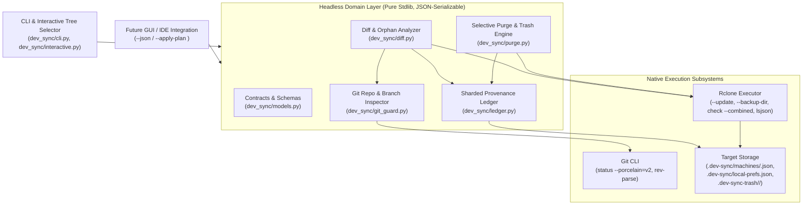

# Smart Diff, Provenance Ledger & Selective Garbage/Purge Architecture Plan

## 1. Executive Summary & Architectural Diagnosis

### Current Architecture & Empirical Gaps
An audit of `dev_sync` (`9` source files, `1,678` lines) and production execution logs (`.logs/dev-sync-*.jsonl`) surfaced four core architectural limitations:

1. **Blind Overwrite & Git Branch Desynchronization (`dev_sync/engine.py#L285-L337`)**:
   - `pull` and `push` invoke `rclone copy` without `--update` (`-u`), `--backup-dir`, or Git working-tree awareness.
   - Pulling from remote storage on Machine B can overwrite newer local files or clobber clean Git-tracked files updated via `git pull` with older versions pushed from Machine A on a different branch.
2. **Lack of Cross-Machine Provenance & Per-Machine Opt-Out**:
   - While `rclone` tracks modification times (`mtime`) and checksums and `git` tracks repository commit state, neither records **which machine** uploaded an untracked companion file (e.g., `NOTES.txt`, `.TODO/`, `.frontier/`, `db.sqlite3`, PDFs), **which Git branch/commit** was active at push time, or whether the current computer wants to **ignore/opt out** of pulling specific remote folders/files locally.
3. **No Selective Folder/File Purge or Garbage Quarantine (`dev_sync/engine.py#L202-L273`)**:
   - `cleanup` only purges build artifacts matching `rclone-ignore.txt`. There is no workflow to inspect differing/orphaned project files grouped by folder and file, choose between **moving to a versioned garbage structure** vs. **permanently deleting** vs. **ignoring locally**, or select targets via an interactive tree or GUI-ready JSON payload.
4. **Modularity Budget & Summary Rollup Defects**:
   - `dev_sync/engine.py` is at **361 lines / 12 methods** (exceeding the 350-line soft warning and at the 12-method ceiling).
   - Several functions in `dev_sync/cli.py`, `dev_sync/engine.py`, `dev_sync/summary.py`, `dev_sync/report.py`, `dev_sync/config.py`, and `dev_sync/filter.py` exceed the 40-line function budget.
   - `dev_sync/summary.py#L84-L104` lacks workspace category prefixes (`core_libraries`, `research_and_experiments`, `rpa_automation`, `web_and_services`) in `CONTAINER_ROOT_PREFIXES` and counts directory `modtime` events as affected files (`dev_sync/summary.py#L220-L246`).

---

## 2. 3-Tier SOTA Architectural Landscape

| Tier | Paradigm | How It Works | Trade-Offs & Verdict |
| :--- | :--- | :--- | :--- |
| **Tier 1: Pragmatic Baseline** | Wrapper Flags Only | Add `--update` and `--interactive` directly to `rclone copy`/`rclone delete` in `engine.py`. | **Rejected**: No Git-tracked protection, no cross-machine origin visibility, no per-machine opt-out, and cannot power a future GUI. |
| **Tier 2: Frontier SOTA (Selected Architecture)** | **Git-Aware Hybrid Sync + Sharded Provenance Ledger + Native `--backup-dir` Garbage Tree + Headless JSON Core** | Combines `rclone` native primitives (`--update`, `--backup-dir`, `check --combined`, `lsjson`) and `git status --porcelain=v2` with a conflict-free sharded ledger (`.dev-sync/machines/<host>.json`), local machine preferences (`.dev-sync/local-prefs.json`), and a GUI-ready JSON domain model (`--json` / `--apply-plan`) driving an interactive numbered folder/file selector (`1, 2.3-2.5`). | **Selected**: 100% Python 3 stdlib, zero external dependencies, Termux-compatible, non-destructive by default, and directly ready for future desktop/mobile GUI integration. |
| **Tier 3: Novel Moonshot** | Daemonized CRDT Virtual Filesystem | Run a continuous background FUSE/daemon watcher maintaining vector clocks per file chunk. | **Deferred**: Violates Termux/CLI simplicity and battery constraints; Tier 2's sharded machine ledger provides 95% of the provenance benefit at 0% background CPU cost. |

---

## 3. Target Architecture & Data Flow



### Key Architectural Invariants
1. **Hybrid Smart Git Policy**:
   - Every `pull` and `push` uses `--update` (`-u`) so newer destination files are never overwritten by older source files.
   - Sub-projects containing `.git` are scanned via `git status --porcelain=v2 --ignored`. Files are classified as:
     - `untracked_companion` (untracked or git-ignored support files like `NOTES.txt`, `.TODO/`, `db.sqlite3`, PDFs): synced freely and tracked in the provenance ledger.
     - `tracked_clean` / `tracked_dirty` (managed by Git commits/branches): protected from silent remote overwrite during `pull` if the remote copy differs or came from a different Git branch/commit, surfacing a warning in the Pre-Flight Diff & Orphan Banner.
2. **Conflict-Free Sharded Provenance Ledger (`.dev-sync/`)**:
   - `.dev-sync/machines/<machine_id>.json`: Written by each host on `push`/`pull`, recording `{rel_path, size, mtime, sha256, origin_machine, last_modified_by, updated_at, git_status, git_branch, git_head}`.
   - `.dev-sync/ledger.json`: Merged human- and GUI-readable view across all machines.
   - `.dev-sync/local-prefs.json` (**local-only, never synced**): Stores `ignored_paths` (folders or files this specific computer opted out of pulling/syncing) and the local `machine_alias`.
3. **Native `rclone --backup-dir` Garbage Structure (`.dev-sync-trash/`)**:
   - Overwritten or purged files default to moving into `<remote>/.dev-sync-trash/<YYYY-MM-DD_HHMMSS>/<rel_path>` (for remote scope) and `<local>/.dev-sync/trash/<YYYY-MM-DD_HHMMSS>/<rel_path>` (for local scope).
   - Protected automatically in `dev_sync/filter.py` with `is_local_only=True` (`-! .dev-sync-trash/**`, `-! .dev-sync/trash/**`, `-! .dev-sync/local-prefs.json`) so normal syncs ignore trash and `cleanup` never deletes trash automatically.
   - Managed via `purge` (`--trash` default vs. `--permanent` vs. `--ignore-local`), `restore`, and `empty-trash [--older-than <days>]`.
4. **Dual-Mode Selective Purge & GUI-Ready JSON Contract**:
   - **Interactive Tree Mode**: Groups differing/orphaned items by **Folder** (`[1] products/rrtools/ (6 files, 22.8 MiB)`) and **Individual File** (`[1.1] products/rrtools/dissertation.pdf [REMOTE-ONLY | UNTRACKED | from: laptop (main)]`). Accepts folder indices (`1, 3`), file ranges (`1.2, 2.1-2.4`), or glob filters, followed by action selection (`[T]rash`, `[P]ermanent`, `[I]gnore on this machine`, `[S]kip`).
   - **Headless / GUI Mode**: `python -m dev_sync diff <target> --json` outputs the full `DiffReport` JSON tree; `python -m dev_sync purge <target> --apply-plan <json_file>` executes a structured `PurgePlan` payload non-interactively.

---

## 4. Phased Implementation Roadmap (1-Milestone-Per-Turn Gate)

### Milestone 1: Pre-Flight Modularity Decomposition, Summary Rollup Fixes & Domain Contracts
Bring all existing modules strictly below the modularity budgets (`< 350` lines/file, `<= 12` methods/class, `<= 40` lines/function), fix the two log-rollup bugs in `summary.py`, and establish the headless JSON data contracts in `dev_sync/models.py`.

- [x] **dev_sync/models.py**: Create JSON-serializable dataclasses (`FileDiffItem`, `FolderDiffNode`, `DiffReport`, `LedgerEntry`, `MachineSnapshot`, `LocalPrefs`, `PurgeItem`, `PurgePlan`) with `.to_dict()` / `.from_dict()` helpers for CLI and future GUI integration.
- [x] **dev_sync/summary.py**: Exclude directory `modtime` events from `total_files` counts, expand `CONTAINER_ROOT_PREFIXES` with `core_libraries`, `research_and_experiments`, `rpa_automation`, and `web_and_services`, and decompose `parse_log_events`, `build_summary`, and `format_terminal_summary` so every function is `<= 40` lines.
- [x] **dev_sync/engine.py**: Decompose `SyncEngine` (`< 300` lines, `<= 10` methods, all functions `<= 40` lines) by extracting diagnostic/bloat helpers and preparing clean hooks for `--update` and `--backup-dir`.
- [x] **dev_sync/cli.py**: Decompose `parse_args` and `main` into focused sub-builders and action dispatchers (`<= 40` lines per function) and remove unused imports across `dev_sync/cli.py`, `dev_sync/engine.py`, `dev_sync/filter.py`, and `dev_sync/summary.py`.
- [x] **dev_sync/config.py**: Decompose `load_targets` into a line parser helper so all functions in `config.py`, `filter.py`, and `report.py` pass the `<= 40`-line budget check, and decompose `TestSyncEngine` in `tests/test_engine.py` (`<= 12` methods/class) and long test functions in `tests/test_filter.py`.
- [x] **tests/test_models.py**: Add unit tests verifying JSON round-trip serialization for `DiffReport`, `FolderDiffNode`, `FileDiffItem`, `LedgerEntry`, and `PurgePlan`, plus regression tests in `tests/test_summary.py` for directory `modtime` exclusion and 2-level workspace category rollup.
- [x] **CHANGELOG.md**: Record milestone completion via `python "<config_dir>/skills/system-diagnostics/scripts/diagnose.py" changelog add`

#### Verification Commands (Milestone 1)
```bash
python "<config_dir>/skills/system-diagnostics/scripts/diagnose.py" audit --path dev_sync tests --max-lines 350 --max-fn-lines 40
python -m unittest discover -s tests -v
python -m compileall dev_sync tests
```

---

### Milestone 2: Git Guard & Sharded Provenance Ledger Engine *(Deferred to Next Turn)*
Implement Git working-tree/branch classification, the sharded cross-machine provenance ledger (`.dev-sync/`), local per-machine opt-out preferences (`local-prefs.json`), and built-in filter protection for trash and local preference files.

- [ ] **dev_sync/git_guard.py**: Implement Git repository discovery and `git status --porcelain=v2 --ignored` + `git rev-parse` inspection to classify files (`tracked_clean`, `tracked_dirty`, `untracked_companion`, `git_ignored`, `non_git`) and detect branch/tracked conflicts without modifying `.git/`.
- [ ] **dev_sync/ledger.py**: Implement conflict-free sharded machine snapshot persistence (`.dev-sync/machines/<machine_id>.json`), merged `.dev-sync/ledger.json` compilation, and `.dev-sync/local-prefs.json` management (`ignore-local`, `unignore-local`, machine identity resolution).
- [ ] **dev_sync/filter.py**: Automatically inject `# @local_only` protection rules for `.dev-sync-trash/**`, `.dev-sync/trash/**`, and `.dev-sync/local-prefs.json` so trash archives and local preferences are never deleted by `cleanup` or synced across machines.
- [ ] **rclone-ignore.txt**: Document and include default `# @local_only` guards for `.dev-sync-trash/**`, `.dev-sync/trash/**`, and `.dev-sync/local-prefs.json`.
- [ ] **tests/test_git_guard.py**: Add unit tests covering sub-repo detection, tracked vs. untracked companion classification, dirty working-tree warnings, and non-Git fallback using isolated `tempfile.TemporaryDirectory()` fixtures.
- [ ] **tests/test_ledger.py**: Add unit tests verifying sharded machine snapshot merging, origin attribution across multiple machines, and local preference opt-out filtering.
- [ ] **CHANGELOG.md**: Record milestone completion via `python "<config_dir>/skills/system-diagnostics/scripts/diagnose.py" changelog add`

#### Verification Commands (Milestone 2)
```bash
python "<config_dir>/skills/system-diagnostics/scripts/diagnose.py" audit --path dev_sync tests --max-lines 350 --max-fn-lines 40
python -m unittest discover -s tests -v
```

---

### Milestone 3: Hierarchical Diff Engine, Native `--backup-dir` Trash & Dual-Mode Selective Purge *(Deferred to Future Turn)*
Wire the hierarchical diff inspector, native `rclone --backup-dir` garbage/trash management, dual-mode interactive/CLI/JSON selective purge, and the Smart Pre-Flight Guard banner for `pull`/`push`.

- [ ] **dev_sync/diff.py**: Implement `DiffAnalyzer` combining `rclone check --combined -` and `rclone lsjson` with `git_guard` and `ledger` to produce hierarchical `DiffReport` trees (`FolderDiffNode` -> `FileDiffItem`) with newer/older status, Git badges, and machine provenance.
- [ ] **dev_sync/purge.py**: Implement headless `PurgeExecutor` supporting `--trash` (via `rclone` native `--backup-dir` into `.dev-sync-trash/<timestamp>/` and local `.dev-sync/trash/<timestamp>/`), `--permanent` deletion, `--ignore-local` preference registration, `restore`, and `empty-trash [--older-than <days>]`.
- [ ] **dev_sync/interactive.py**: Implement the terminal numbered Folder/File Tree renderer and selector parser (`1, 3, 2.1-2.4`, action prompts `[T]rash / [P]ermanent / [I]gnore locally / [S]kip`) decoupled from `PurgeExecutor`.
- [ ] **dev_sync/engine.py**: Upgrade `pull`, `push`, and `check` to use `--update` (`-u`), automatic `--backup-dir` protection on overwrites, `local-prefs.json` exclusions, ledger snapshot updates, and the Smart Pre-Flight Diff & Orphan Banner.
- [ ] **dev_sync/cli.py**: Wire `diff`, `purge`, `restore`, and `empty-trash` actions plus `--json`, `--apply-plan`, `--select`, `--scope`, `--trash`, `--permanent`, `--ignore-local`, and `--yes` flags; update `sync-projects.ps1` and `sync-projects.sh` passthroughs if needed.
- [ ] **tests/test_diff_and_purge.py**: Add unit tests for hierarchical diff tree assembly, selector parsing (`1, 2.3-2.5`), trash vs. permanent vs. ignore-local plan execution, `restore`, `empty-trash`, and `--json` / `--apply-plan` GUI contracts.
- [ ] **README.md**: Update documentation, architecture overview, and the **Scenario Combinations Matrix** (`AGENTS.md` updated in-place under 40 lines if ownership deltas change).
- [ ] **CHANGELOG.md**: Record milestone completion via `python "<config_dir>/skills/system-diagnostics/scripts/diagnose.py" changelog add`

#### Verification Commands (Milestone 3)
```bash
python "<config_dir>/skills/system-diagnostics/scripts/diagnose.py" audit --path dev_sync tests --max-lines 350 --max-fn-lines 40
python "<config_dir>/skills/system-diagnostics/scripts/diagnose.py" scan --path .
python -m unittest discover -s tests -v
python -m dev_sync --test-filter
```

---

## 5. Scenario Combinations Matrix (Target End-State)

| Scenario / Objective | Target | Mode / Flags | Windows (PowerShell) | macOS / Linux / Termux (Bash) | Direct Python |
| :--- | :--- | :--- | :--- | :--- | :--- |
| **Inspect Differing Folders & Files (Tree View)** | `projects` | Read-only diff + provenance | `.\sync-projects.ps1 diff projects` | `./sync-projects.sh diff projects` | `python -m dev_sync diff projects` |
| **Export Diff Tree for GUI / Automation** | `projects` | `--json` | `.\sync-projects.ps1 diff projects --json` | `./sync-projects.sh diff projects --json` | `python -m dev_sync diff projects --json` |
| **Interactive Selective Purge (Folders or Files)** | `projects` | Guided tree (`[T]rash` / `[P]ermanent` / `[I]gnore`) | `.\sync-projects.ps1 purge projects` | `./sync-projects.sh purge projects` | `python -m dev_sync purge projects` |
| **Scripted Purge to Garbage Tree (`.dev-sync-trash`)** | `projects` | `--select <pat> --scope remote --trash` | `.\sync-projects.ps1 purge projects --select "products/rrtools/*.pdf" --scope remote --trash` | `./sync-projects.sh purge projects --select "products/rrtools/*.pdf" --scope remote --trash` | `python -m dev_sync purge projects --select "products/rrtools/*.pdf" --scope remote --trash` |
| **Scripted Permanent Purge** | `projects` | `--select <pat> --permanent --yes` | `.\sync-projects.ps1 purge projects --select "old_folder/**" --permanent --yes` | `./sync-projects.sh purge projects --select "old_folder/**" --permanent --yes` | `python -m dev_sync purge projects --select "old_folder/**" --permanent --yes` |
| **Opt-Out / Ignore Files on Current Machine Only** | `projects` | `--select <pat> --ignore-local` | `.\sync-projects.ps1 purge projects --select "heavy_project/**" --ignore-local` | `./sync-projects.sh purge projects --select "heavy_project/**" --ignore-local` | `python -m dev_sync purge projects --select "heavy_project/**" --ignore-local` |
| **Execute GUI / JSON Purge Plan** | `projects` | `--apply-plan <file>` | `.\sync-projects.ps1 purge projects --apply-plan plan.json` | `./sync-projects.sh purge projects --apply-plan plan.json` | `python -m dev_sync purge projects --apply-plan plan.json` |
| **Restore Files from Garbage Tree** | `projects` | `restore --select <pat>` | `.\sync-projects.ps1 restore projects --select "products/rrtools/*"` | `./sync-projects.sh restore projects --select "products/rrtools/*"` | `python -m dev_sync restore projects --select "products/rrtools/*"` |
| **Empty Garbage Tree by Retention Age** | `projects` | `empty-trash --older-than 30` | `.\sync-projects.ps1 empty-trash projects --older-than 30` | `./sync-projects.sh empty-trash projects --older-than 30` | `python -m dev_sync empty-trash projects --older-than 30` |
| **Smart Pull (Newer-Protected + Git Guard)** | `projects` | Auto `--update` + `--backup-dir` | `.\sync-projects.ps1 pull projects` | `./sync-projects.sh pull projects` | `python -m dev_sync pull projects` |
| **Smart Push (Newer-Protected + Ledger Update)** | `projects` | Auto `--update` + ledger sync | `.\sync-projects.ps1 push projects` | `./sync-projects.sh push projects` | `python -m dev_sync push projects` |
